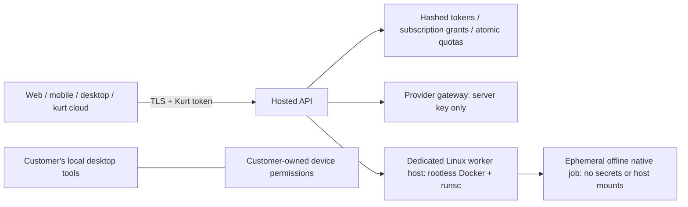

# Kurt SaaS foundation

Status: implemented and tested locally; **not deployed and not approved for paid production launch**. This is an execution/authentication foundation, not a finished billing system, website, mobile app or desktop distribution. No cloud resources or payment accounts were created.

## Shared product boundary

Web/mobile/desktop/CLI clients authenticate to one hosted API using revocable Kurt tokens. Provider API keys stay in the server secret environment. Each authenticated token resolves to a server-owned tenant and subscription; the client cannot supply its own tenant, plan, provider URL, model, worker image, command or host file path.

Desktop control stays on the customer's own machine. The cloud API cannot issue mouse/keyboard commands to a device. Device pairing and per-action consent must be designed before adding remote desktop orchestration. The existing personal CLI continues to work separately; hosted commands are explicitly under `kurt cloud`.



## Implemented behavior

- `/v1/me`: the caller's subscription only. `/v1/chat`: bounded text messages to an allowlisted model, no remote tools, no history retention. `/v1/native/run`: explicit records and a native capability ID, executed in an approved image. `/health`: liveness only, not a production-readiness attestation.
- Opaque 256-bit tokens are stored only as SHA-256 hashes. Tokens expire, tenant-wide revocation is immediate for new requests, and expired subscriptions cannot start jobs. Existing in-flight work may finish.
- Server-side Starter/Pro quotas are 100/1,000 accepted work requests per UTC day, 10/30 per minute and 1/2 concurrent jobs. The host caps in-flight work at 16. These are prototype entitlement policies, not payment prices or monetary metering. Failed execution attempts consume quota. Invalid requests are bounded but require edge rate limiting before production.
- Atomic SQLite transactions prevent concurrent quota races. Tenant-scoped leases and metadata-only audit events contain no prompts, records, replies, provider keys or plaintext device tokens. SQLite supports a single control-plane host here; this is not a distributed scheduler.
- No shared conversation memory or tenant dataset directory exists. Records travel over TLS, then stdin to a fresh container, then a bounded response to the same request. Job input uses anonymous memory-backed file descriptors rather than disk spool files. Records are not mounted from host paths or saved as Docker logs. Containers have no networking, run as a numeric non-root user, drop capabilities, have a read-only root, 16 MiB temporary storage, CPU/RAM/PID/output/time limits and automatic removal. The worker has an internal alarm in addition to its supervisor deadline.
- No client-selected shell, browser, MCP server or plugin code is executed in hosted mode. The existing recipe engine is reused as a fixed deterministic offline workload; these are not arbitrary third-party plugin sandboxes.
- The worker requires a reviewed `@sha256:` image, rootless Docker, cgroup v2, advertised memory/CPU/PID support and an installed runtime whose configured path is `runsc`. Missing prerequisites fail closed. No fallback to ordinary containers, Mac desktop execution or host shell exists.
- HTTPS is required on authenticated API routes. Proxy-forwarded schemes are trusted only from an explicitly configured local proxy. Bearer auth uses no cookies, and no permissive browser CORS policy is enabled. Provider and client HTTP libraries ignore ambient proxies and refuse redirects.

The runtime choice follows the official [gVisor Docker guide](https://gvisor.dev/docs/user_guide/quick_start/docker/). Rootless resource control requirements follow [Docker's rootless documentation](https://docs.docker.com/engine/security/rootless/). These controls do not constitute proof against every kernel/runtime vulnerability.

## Review locally

```sh
python3 -m unittest discover -s tests -p test_saas.py -v
kurt cloud --help
```

The tests use synthetic credentials and an in-process ASGI transport. A real native recipe also runs in a dependency-free worker subprocess (`python -S`). That subprocess test verifies the worker implementation, **not container isolation**. Docker and gVisor are unavailable on the current development machine, so live Linux container escape/resource/network tests have not run.

### Smoke-testing the real server and CLI (not just the test suite)

The commands above never actually open a socket — `create_app()` is untested
by them. A real run exposed a gap the in-process tests structurally cannot
catch: `create_app()` defaults `require_https=True`, and a bare `uvicorn`
process with no reverse proxy in front always reports a plain-HTTP scheme,
so every real request gets refused with `400 https_required` — including
from localhost. This is correct for production (HTTPS is terminated by the
proxy in `deploy/saas/kurt-api.service`), but it means you cannot smoke-test
the real server without one unless you opt out explicitly:

```sh
export KURT_SAAS_STATE_DIR=/tmp/kurt-saas-dev
export KURT_SAAS_DEV_INSECURE_HTTP=1   # local-only; never set this in production
python3 -m uvicorn kurt.saas.app:create_app --factory --host 127.0.0.1 --port 8099 &

python3 -m kurt.saas.admin --state-dir "$KURT_SAAS_STATE_DIR" grant --plan starter --token-file /tmp/dev.kurt-token

export KURT_CLOUD_URL=http://127.0.0.1:8099
export KURT_CLOUD_TOKEN=$(cat /tmp/dev.kurt-token)
kurt cloud status   # should return the real tenant/plan/expiry
kurt cloud ask 'hi'  # 503 until KURT_SAAS_GROQ_KEY is also set
```

Verified by running exactly this sequence: `/health`, admin token issuance,
and `kurt cloud status`/`ask` all behaved as documented against a real
running process, not just the ASGI test transport.

## Provisioning outline — operator only

Use separate identities/hosts for public web/mobile backend, provider-key custody and the worker runtime. The supplied API and runner are a single-host prototype boundary; do not mount a Docker socket into a public web frontend. Access to a container daemon is privileged. Split the runner into a private authenticated job service before multi-host deployment.

1. Provision a dedicated Linux worker account and install rootless Docker + `runsc` using their official guides. Validate cgroup v2 controller delegation. Audit the runtime binary/configuration and host hardening.
2. Build `deploy/saas/Worker.Dockerfile` with a reviewed digest-pinned `PYTHON_BASE`. The image deliberately contains no Node/desktop/provider SDKs and installs no packages. The root `.dockerignore` allowlists only the offline worker sources/data so local keys, state and Node dependencies are excluded from the build context. Scan/sign the built image, push it to a private registry, pull it under the worker account and record its registry digest. Requests never pull images.
3. Install the API environment with `pip install '.[saas]'`. Supply private server settings following `deploy/saas/api.env.example`. Keep the actual environment file outside the repo, mode 0600, preferably sourced from a secret manager. Never copy a provider key into a client build.
4. Review `deploy/saas/kurt-api.service`, its service account/state permissions and the private worker socket path. Put an authenticated API behind a TLS reverse proxy with request limits. Do not trust forwarded headers from arbitrary clients. Configure edge logs to omit Authorization headers and query parameters. One API worker process and a private single-host SQLite store are the supported prototype configuration.
5. An operator can create a temporary subscription grant without putting a token in stdout:

   ```sh
   python3 -m kurt.saas.admin --state-dir /var/lib/kurt-saas grant --plan starter --days 30 --token-file /secure/customer-device.kurt-token
   ```

   This is an operator grant, **not a completed purchase**. The token file is created exclusively with mode 0600. Transfer it only through a secure provisioning flow; never commit or email it. To revoke all devices for the returned tenant:

   ```sh
   python3 -m kurt.saas.admin --state-dir /var/lib/kurt-saas revoke TENANT_UUID
   ```

## CLI client

Set `KURT_CLOUD_URL` to the HTTPS API origin. Obtain `KURT_CLOUD_TOKEN` from secure provisioning/OS credential storage; do not paste it into shell history or publish it in a frontend bundle. These commands use the Kurt token, not a Groq/OpenAI key:

```sh
kurt cloud status
kurt cloud ask 'Explain this sales trend'
kurt cloud run kurt-skill--shopee-orders--gross_sales--describe --input ./orders.csv
```

The `run` command explicitly uploads those records. It does not connect to Shopee, download customer accounts, or upload the rest of the device. Token refresh, OS-keychain integration and interactive sign-in are not implemented yet. Browser clients need a reviewed login/BFF and CSRF/session design rather than putting a shared token into JavaScript.

## Required before selling subscriptions

- Verify payments and subscription events with the chosen billing provider, including signature checks, replay protection, refunds/cancellations and idempotent entitlement updates. There is no billing webhook or client-side plan upgrade endpoint in this foundation.
- Add account login, verified device pairing, per-device revocation, recovery and secure token refresh. Separate account members and organization roles if teams are supported.
- Run live isolation tests on the actual Linux worker: cross-tenant data access, malicious inputs, process exhaustion, network egress, absent provider credentials, read-only root, deadline cleanup and supervisor crash recovery. Test runtime/image upgrades before rollout.
- Split the worker broker from the public API and key gateway; use authenticated internal transport and least-privilege identities. Move quota/lease/account state to a transactional production store before multiple API hosts. Add encrypted backups, key rotation, retention/deletion and operational audit controls.
- Add edge throttling, spend/token budgets, abuse controls, usage reconciliation, alerting and incident response. Current request quotas are not accurate monetary billing or a provider-cost ceiling.
- Finish the actual web/mobile/desktop clients, platform distribution/signing, tenant-scoped persistence (if introduced), privacy terms and a security review. The earlier 33 moderate Node dependency advisories also remain in the local desktop toolchain; the offline cloud worker does not include that toolchain.

Do not label this release “production-ready SaaS” until those deployment and product gates pass.

Local verification: all 117 project tests passed, including 24 SaaS boundary tests. `kurt cloud --help`, Python compilation and whitespace checks passed. No live Linux container runtime test or paid billing flow is included in that result.
