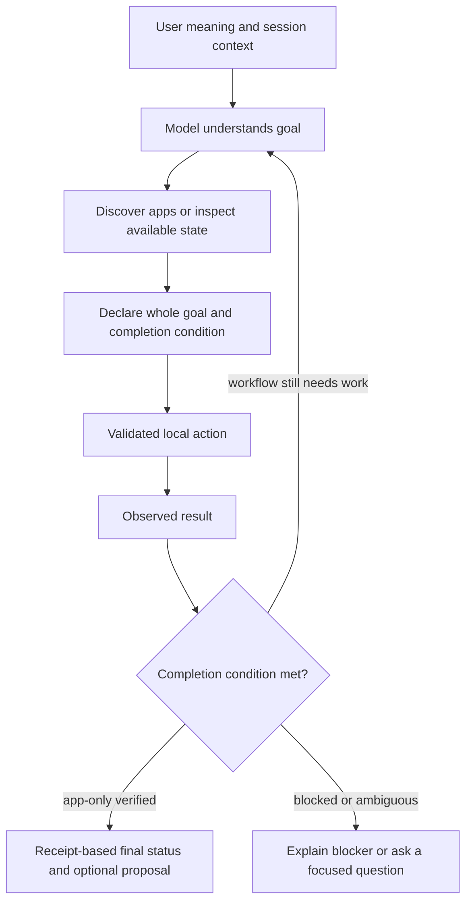

# Goal-directed ordinary chat

Normal `kurt chat` now starts with a tool-capable conversational model for every
ordinary message. User wording does not select a keyword/regex intent handler,
pre-fetch a URL, or gate access to app tools. Slash commands remain explicit
commands. Quick literal shortcuts in `ask`/`do` and standalone voice are separate
conveniences; unmatched speech also uses the semantic tool planner.

The model receives tool contracts, understands the user's goal and conversation
context, discovers installed apps, and chooses actions. It declares the whole
goal through `set_task_goal` before a semantic action can execute. The executor
validates required arguments and returns actual local evidence. There is no
fixed number of response layers: the model can observe, act and adjust within a
24-tool-call budget. Questions can receive an answer without any app action.



## Completion and initiative

`app_foreground` means the entire user request is just to show/prepare the chosen
app. The model supplies an exact target app; only activation of that target is
permitted. The native helper verifies its active foreground PID. On success the
controller ends execution and formats the final status from the receipt, rather
than allowing another model turn to click controls or invent document readiness.
An optional short next-step proposal comes from the model's goal declaration;
it is not executed. Discovery/read-only checks can happen before the plan.

`workflow` is for goals requiring more than activation. The model must preserve
the full request, interact using fresh observations and required-field tools,
inspect effects and continue. Opening an app does not establish that typing,
document creation or a requested browser result happened. Failed/indeterminate
mutations must be observed before deciding another action. Identical rejected
requests stop, and all workflows retain the step bound. Workflow final-state
interpretation still depends on the model; it is not a universal proof engine.

Useful initiative means doing the necessary steps within the goal. Missing
material details justify one focused question. Optional suggestions do not
authorize sending, buying, deleting, publishing, installing or unrelated work.

## Local tools and context

App discovery and activation run through a fixed, short-lived Cocoa helper on
its own main thread. This avoids stale activation notifications in model worker
threads. The helper accepts installed app names, not scripts or arbitrary shell
commands. A timeout is an unknown outcome and is not replayed automatically.

Dedicated browser/interaction tools have required parameters (`fill_field`,
`press_key`, etc.), replacing the ambiguous all-optional desktop action schema
in ordinary native function declarations. Existing raw/legacy dispatch remains
compatible for explicit callers. Mail unread counts, local Music playback,
bounded direct downloads and configured media generation are also available to
the planner; their existing service/account limitations remain.

Disk memory can be disabled while recent user/assistant context remains in RAM.
This supports “balik sa una” without writing conversation history. A new user
request cannot inherit a completed previous goal as if it were its own. Within
a task, compact execution receipts survive removal of old screen trees and
provider fallback preserves completed work.

## Evidence and limits

**216 tests and 318 subtests passed.**

The [semantic chat report](semantic-assistant-verification.json) passed **4/4**:
implicit arithmetic and plain-text goals without app names, a contextual
follow-up in the same no-disk-memory session, and a question without app
mutations. Foreground apps were independently observed from a fresh process.
App-only cases ended after verified activation without clicking controls.

The [Safari workflow report](desktop-input-semantic-safari-verification.json)
passed actual installed chat navigating a local page, entering a unique code,
pressing Enter, hovering and scrolling. The page's independent `INPUT_OK` title
requires the code to reach its Enter handler and the later hover/scroll effects
to occur. This exercises continuation beyond app opening.

Earlier semantic reports retain failures before the goal guard and a verifier
mistake that required OS focus to remain fixed during a read-only answer. The
current read-only criterion checks that no mutation tool was used; a user/OS
focus change alone does not establish an assistant action.

These results establish the tested scenarios, not all apps, websites, models or
goals. This is accessibility-based interaction, not newly added cloud screenshot
vision or a copy of any proprietary model internals. Provider limits and macOS
permissions still apply. Already-running Kurt sessions must restart to load it.

```sh
python3 tools/verify_semantic_assistant.py --live --output /tmp/kurt-semantic.json
python3 tools/verify_desktop_input.py --live --browser Safari --model openai/gpt-oss-120b --output /tmp/kurt-workflow.json
```
